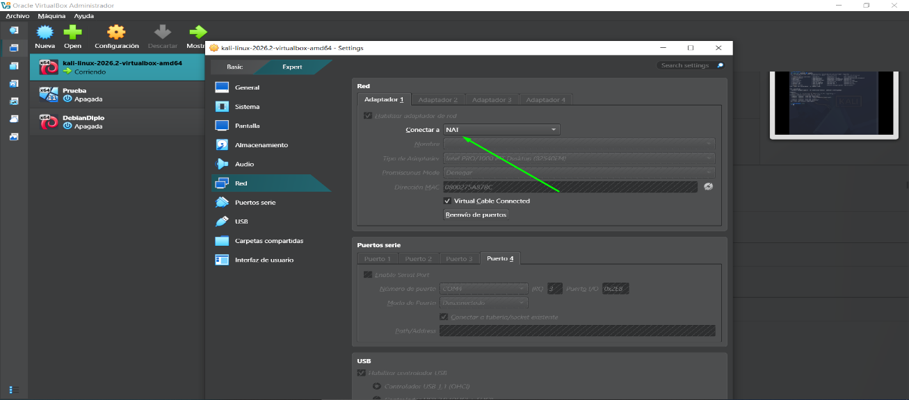
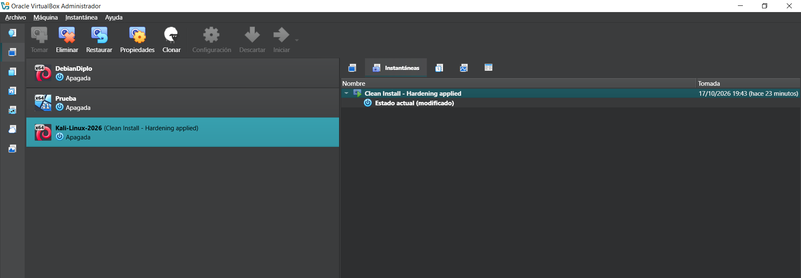
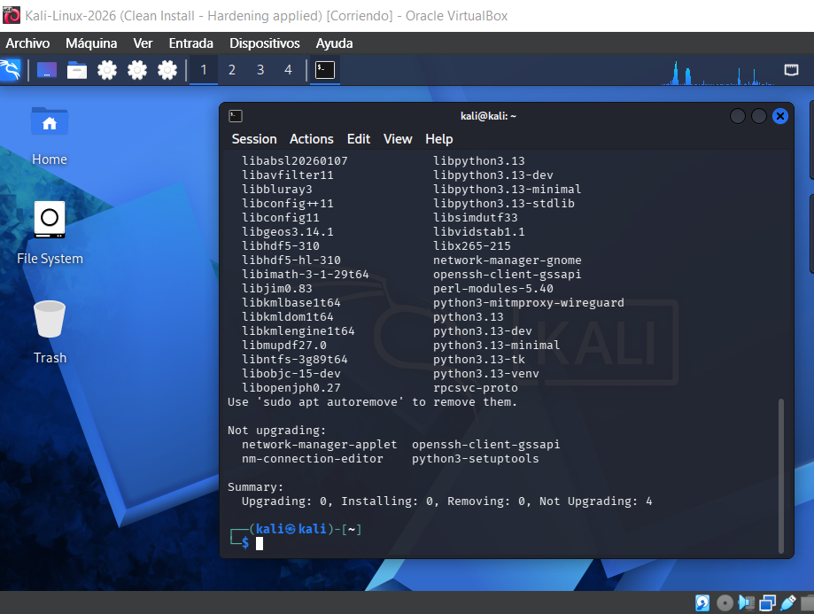

# Reporte Técnico de Configuración de Laboratorio - Kali Linux

## 1. La Fundación: VirtualBox y Red Aislada

*(Configuración de red en Modo NAT)*

Utilizar NAT en VirtualBox como opción segura, simple y aislada cuando necesitas que tu VM Linux tenga Internet sin exponerla a tu red real. Dando prioridad al aislamiento y facilidad de configuración.

### ¿Cómo protege mi máquina Host?

**1. Aislamiento de red e identidad:**
* La VM no tiene IP visible en tu LAN.
* Ningún equipo externo puede escanear ni atacar servicios dentro de la VM.
* Tu red real solo ve tráfico del host, no de la VM.
* La VM queda "camuflada" detrás de tu PC.

**2. Barrera contra malware:**
* Si la VM se infecta, el malware no puede propagarse fácilmente a tu host ni a otros equipos de tu red.
* El tráfico malicioso queda "atrapado" detrás del NAT.

**3. Tu host no reenvía tráfico entrante:**
* VirtualBox solo traduce las conexiones salientes de la VM.
* Las conexiones entrantes desde Internet no llegan a la VM (salvo que configures reenvío de puertos manualmente).

---

## 2. Capa Linux: Permisos y Gestión

* **Nombre:** Kali Linux
* **Versión:** 2026.2 (basada en Debian)
* **Arquitectura:** amd64 (64 bits)
* **Entorno:** Es una máquina virtual (imagen .vdi) lista para VirtualBox.
* **Familia:** Debian

### La Red de Seguridad: Snapshot Inicial

Captura del Administrador de Instantáneas (Snapshots) de VirtualBox donde se ve una instantánea llamada **"Clean Install - Hardening applied"**. Esta es tu "máquina del tiempo" por si algo sale mal en el futuro.

---

## 3. Gestión de Paquetes (APT)

### Sudo Apt Update

* **Sudo:** Para dar permiso como Superusuario.
* **Apt:** Como gestor de paquetes.
* **Update:** Comando para actualizar.

Este comando permite actualizar el “Catálogo”, le pregunta a los servidores de Kali si hay programas nuevos o versiones más recientes.

### Sudo Apt Upgrade

* **Sudo:** Para dar permiso como Superusuario.
* **Apt:** Como gestor de paquetes.
* **Upgrade:** Comando para instalar.

Este comando le ordena al gestor de paquetes que revise todos los programas instalados y los actualice a su versión más reciente.
